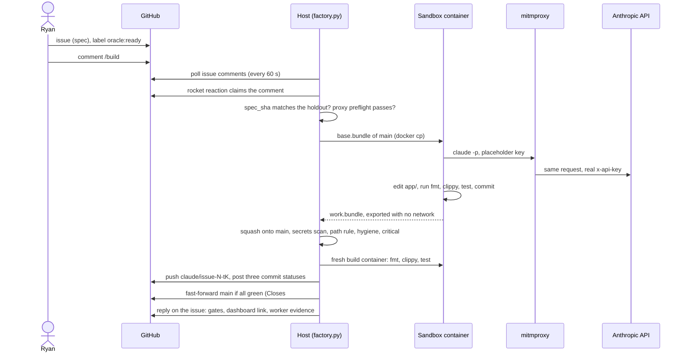
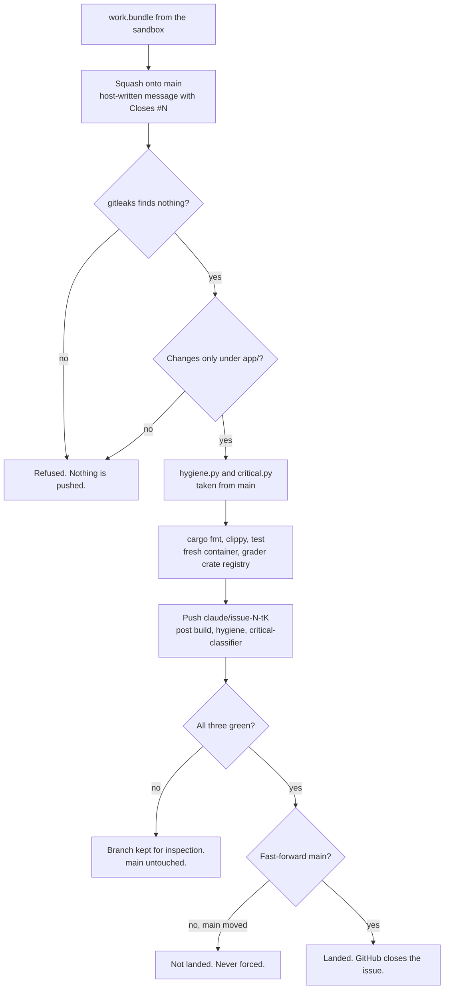
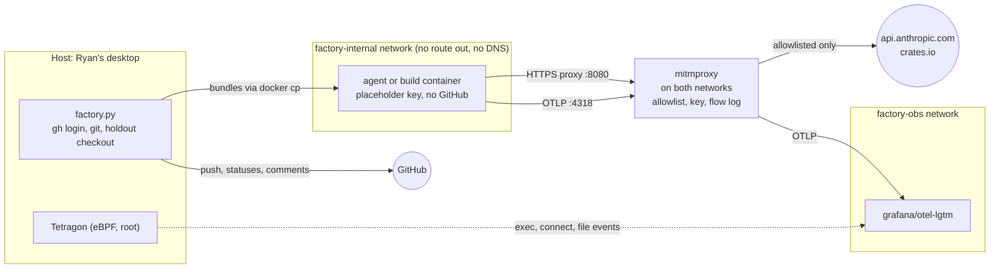
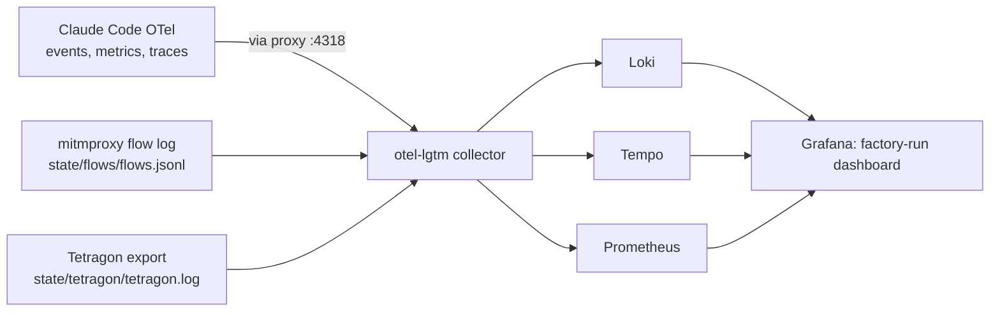

# Factory architecture

How a GitHub issue becomes a commit on `main` with no PR and no human in the loop, and
how each step is contained and observed. The design and schedule are in [PLAN.md](PLAN.md),
the results in [JOURNAL.md](JOURNAL.md), and the operating details in
[sandbox/README.md](sandbox/README.md).

**This is a demonstration, not a hardened deployment.** See [Known limits](#known-limits).

## The pieces

| Piece | Where | Role |
| --- | --- | --- |
| Spec | GitHub issue body | What to build. Frozen by a `spec_sha` once the oracle is written. |
| Oracle | [holdout repo](https://github.com/rhprasad0/factory-scoreboard-holdout), `tasks/<issue>/` | Hidden black-box tests written from the spec alone. The worker never sees them. |
| Trigger | A `/build` comment by Ryan on an issue labeled `oracle:ready` | Each comment is one trial. |
| Host | `sandbox/host/factory.py`, run every 60 s by a systemd user timer | Holds the GitHub login. Runs the job, grades it, lands it. |
| Worker | `claude -p` in the `factory-agent` container | Writes the code under `app/` and commits. Has no GitHub access and no real API key. |
| Proxy | mitmproxy (`sandbox/proxy/`) | The container's only way out: allowlist, API key injection, flow log. |
| Graders | `factory/hygiene.py`, `factory/critical.py`, and cargo fmt/clippy/test | Run by the host, always from `main`, on the exact commit that would land. |
| Observability | grafana/otel-lgtm, Tetragon | Agent, network and OS events for every job on one dashboard. |
| Product | `app/` | The scoreboard API (Rust, axum, Lambda) that the factory is building. |

## One trial, end to end



Before a job starts, the host refuses it if the issue lacks `oracle:ready`, if the issue
body no longer matches the frozen `spec_sha`, or if the proxy preflight fails. The
preflight checks that a blocked host really is blocked and that key injection works,
because mitmproxy serves as an open proxy if its addon unloads (journal, t4).

## Gates and landing

There are no PRs. The host grades the commit that would land, not the agent's branch,
and moves `main` only when every gate is green.



| Gate | Status context | Blocks landing? |
| --- | --- | --- |
| Secrets: gitleaks with the host's config, before any push | none (refused, nothing pushed) | Yes |
| Build: `cargo fmt --check`, `cargo clippy --all-targets -- -D warnings`, `cargo test` | `build` | Yes |
| Hygiene: no deleted or skipped tests | `hygiene` | Yes |
| Critical classifier: dependency, data model, API contract, oversized, labeled `critical` | `critical-classifier` | No. Signals are reported on the status and the issue until the review station exists. |
| Oracle: hidden tests against the running app | `oracle` | Planned (Stage 4) |

Why the gates can be trusted:

- **The graders come from `main`,** not from the trial, so a change can't rewrite the
  check that grades it.
- **The build reruns in a fresh container.** The worker's own claim that tests passed
  counts for nothing.
- **The host writes the commit message.** Agent text never reaches main's history, so it
  can't close other issues or ping anyone.
- **Branch protection enforces the gates.** `main` requires the three statuses, and the
  host posts them on the commit before it pushes. The first live landing (t7) was
  accepted on those statuses alone, with no admin bypass.

## Containment



| The agent... | How |
| --- | --- |
| can reach only Anthropic and crates.io | `factory-internal` is an internal Docker network. The proxy allowlists four hosts and returns 403 for the rest, logging each one. GitHub is not on the list, so the holdout repo is unreachable. |
| never holds the API key | The container has a placeholder. The proxy strips client credentials and sets the real `x-api-key`. |
| can't search the web | `WebSearch` runs on Anthropic's servers, past the proxy, so it and `WebFetch` are disabled. |
| can't touch GitHub | The host does every GitHub action with Ryan's `gh` login, which never enters a container. |
| can't run code on the host through git | The host never runs git in a repo the agent could write to. Work comes out as a git bundle (objects and refs, no hooks or config), exported from a container with no network, and is fetched into a fresh clone. |
| can't poison the graders' crates directly | Worker and build containers use separate cargo registry volumes. |
| runs without permission prompts | `--dangerously-skip-permissions`, because the container is the boundary. Linux capabilities dropped, `no-new-privileges`, limits of 8 CPUs, 8 GB memory and 1024 processes, 30-minute timeout. |

## Observability



Each layer carries the job's identity, so one dashboard URL shows the whole trial:

| Layer | What it shows | Job tag |
| --- | --- | --- |
| Agent | Prompts, model requests, tool calls, cost, traces (`claude_code.interaction`, then `llm_request` and `tool`) | `factory.job_id` resource attribute |
| Network | Every request the container made, allowed or blocked, with bytes and status | `job_id` from the host-written `state/current-job` |
| OS | Process execs, socket connects, opens of sensitive files | Container ID (first 31 characters) |

The host's issue reply links the dashboard with the job and container filled in. Grafana
listens on `localhost:3300` only.

## Repository map

```
app/                 the product the factory builds (Rust workspace, openapi.yaml)
factory/             graders and contracts: hygiene.py, critical.py, friction.py, record.py
sandbox/
  host/              factory.py (poll, worker) and its tests
  agent/             worker image: Rust, cargo-lambda, Claude Code, proxy CA
  proxy/             mitmproxy image and allowlist addon
  otel/, grafana/    collector config and the factory-run dashboard
  tetragon/          Tetragon config and tracing policy
  systemd/           factory-poll service and timer
records/             trial records (JSONL), from Stage 5
journal/             weekly experiment pages
```

The holdout oracles live in a separate repo. The host reads only `tasks/<issue>/task.json`
from a local checkout, for the `spec_sha` check.

## Status

| Station | State |
| --- | --- |
| Spec, oracle authoring | Human (Ryan) |
| Worker | Live, local sandbox (since 2026-11-11) |
| Build, hygiene, critical gates | Live, run by the host before landing |
| Landing on `main` | Live, no PRs. First landing: T-001, trial t7, `e7fe1cf` |
| Oracle gate | Planned (Stage 4): app and DynamoDB Local offline, holdout tests in a separate container |
| Trial records | Planned (Stage 5): the record schema still requires `pr` |
| Review station, deploy, bench | Later, per PLAN.md |

GitHub Actions runs only `gitleaks.yml`, a full-history secrets scan on every push. It is a
backstop, not a required check: the host's scan has already run before anything is pushed.

## Known limits

- **Shared kernel.** The agent's container shares a kernel with Ryan's workstation.
  Tetragon observes but does not block.
- **The grader registry is writable during the build.** The build container runs the
  trial's own build scripts and tests, so one trial could tamper with crates a later
  trial's build uses.
- **Everything outside `app/` is refused,** even when an issue asks for it. Infra tasks
  will need a rule for that.
- **Critical changes land.** Signals are reported, not enforced, until the review station
  exists.
- **Human pushes are ungated.** Nothing posts statuses for Ryan's own commits, so they go
  through on admin bypass.
- **One job at a time.** The systemd oneshot serializes jobs. A long trial delays the next
  `/build`.
