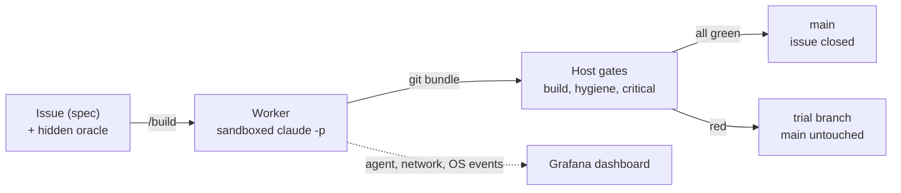

# factory-scoreboard

A software factory that evaluates itself from commit zero, and the scoreboard it builds to display those evaluations.

Ryan writes a GitHub issue as the spec and an oracle (hidden tests) for it, then comments
`/build`. A Claude worker builds it in a sandboxed container on Ryan's desktop. The host
grades the result and lands it on `main` with no PR when every gate is green.

- [Architecture](ARCHITECTURE.md): how a trial runs, how it is graded and landed, how the
  sandbox is contained and observed, with diagrams.
- [Plan](PLAN.md): what this is, how the factory is gated, and the eight-week schedule.
- [Experiment journal](JOURNAL.md): hypotheses, baselines, results, costs, decisions, by week.
- [Sandbox operations](sandbox/README.md): setup, running a job, findings.
- [Factory contract](factory/README.md): tasks, trials, graders and merge policy.
- [Worker instructions](CLAUDE.md): the rules the worker follows.
- Oracles live in the separate public [holdout repository](https://github.com/rhprasad0/factory-scoreboard-holdout). The worker's sandbox has no route to GitHub.

**Status (2026-11-11):** the worker and its gates run locally, and GitHub Actions runs
nothing for this repo. T-001 (`GET /health`) was the first task the factory landed on
`main` by itself. The oracle gate and trial records are next.
